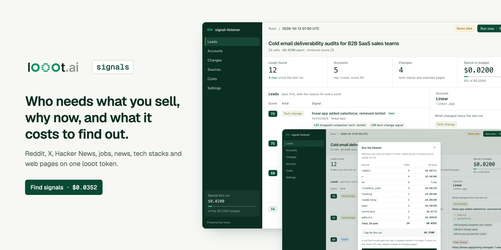
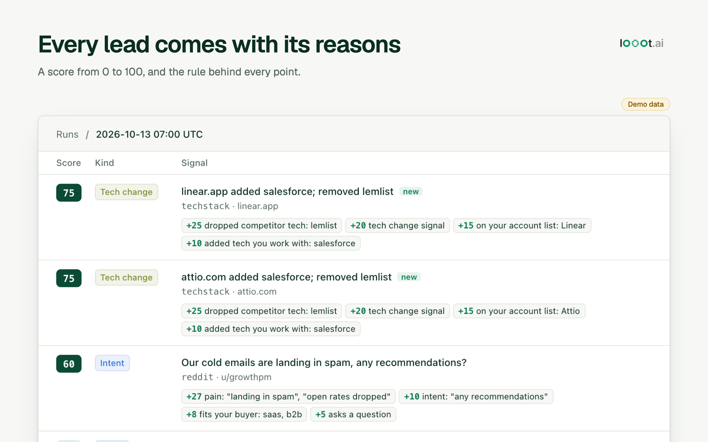
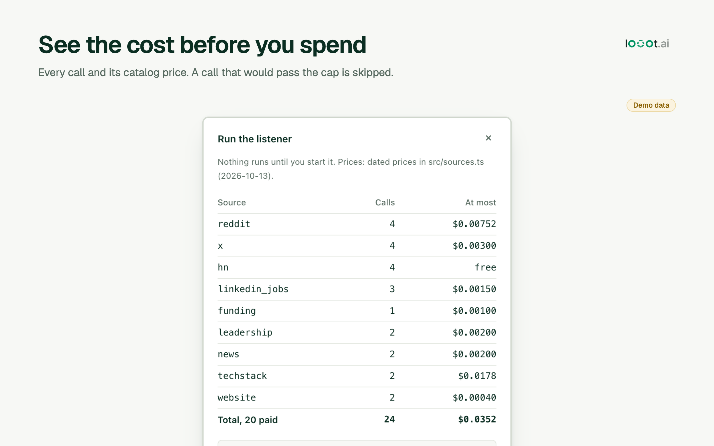
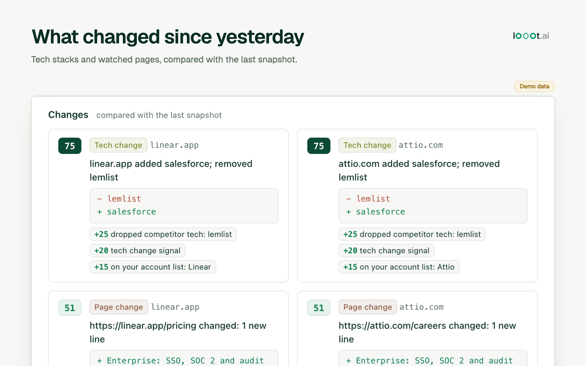
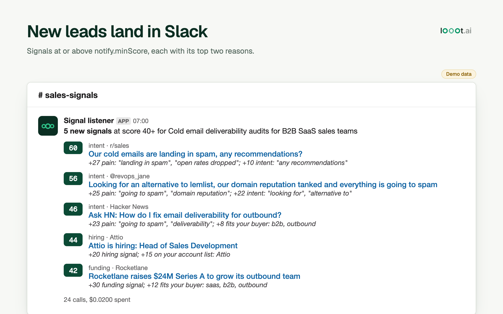
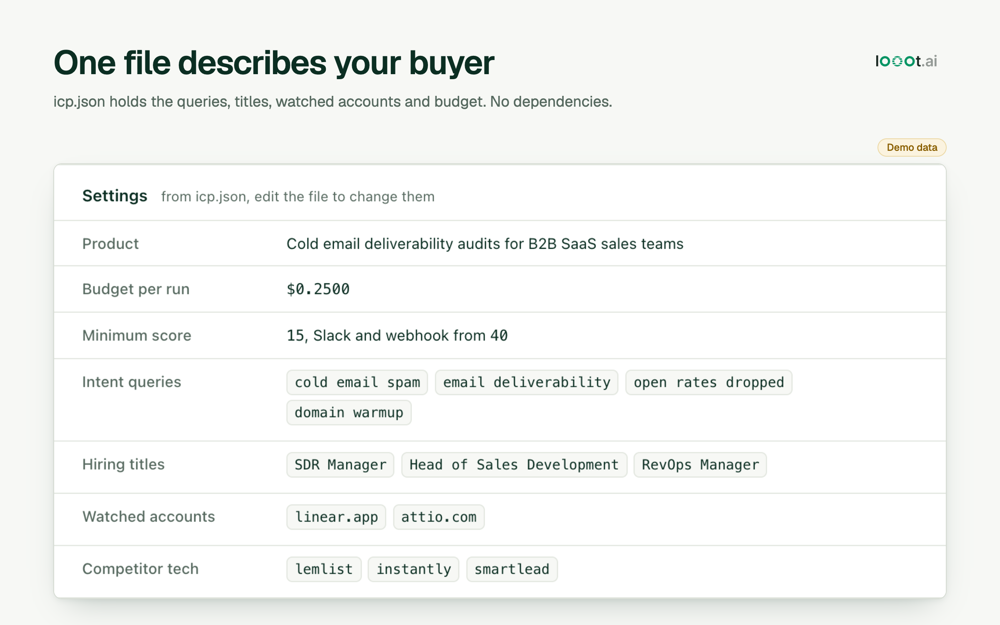
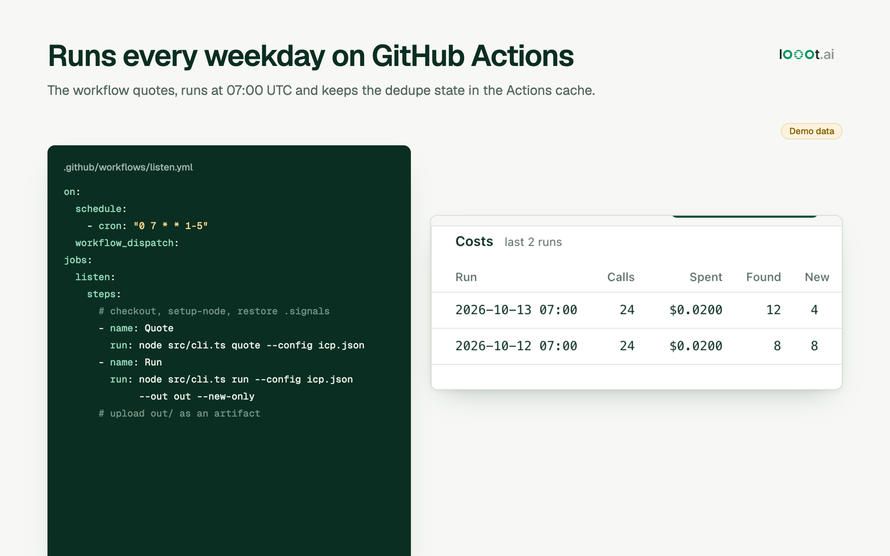
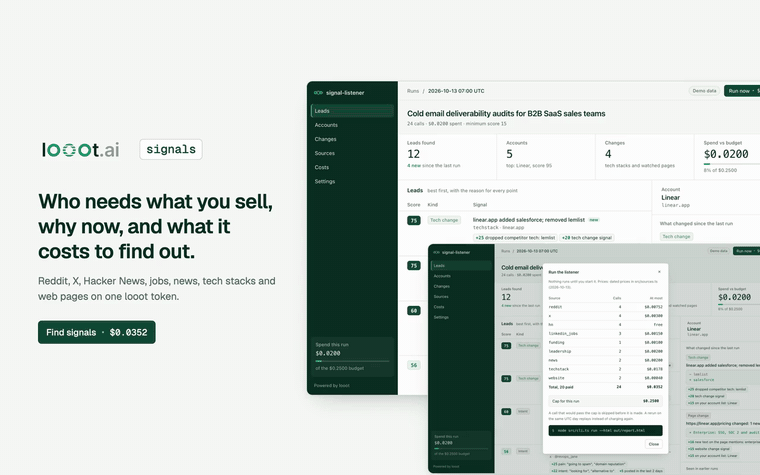

# looot-signal-listener

Finds people and companies that need what you sell right now, scores each one, and tells you why.

<table>
<tr>
<td width="50%"></td>
<td width="50%"></td>
</tr>
<tr>
<td></td>
<td></td>
</tr>
<tr>
<td></td>
<td></td>
</tr>
</table>

Every screenshot is the real HTML report (`node src/cli.ts report`), filled by running the test fixtures through the real engine twice, a day apart. That is why each one says "Demo data". The Slack card shows the real `slackPayload()` text for the same run.



The same walkthrough as MP4: [docs/media/demo.mp4](docs/media/demo.mp4).

## How it works, in three steps

1. Describe your buyer once in `icp.json`: the pain phrases they use, the job titles that mean they have your problem, the accounts you watch.
2. Run it. It asks Reddit, X, Hacker News, LinkedIn jobs, the news, a tech stack lookup and web pages, all through one looot key, and never spends past `budgetUsd`.
3. Read the result. Each signal has a score from 0 to 100 and the reason for every point. Open `out/report.html`, or get new ones in Slack, a webhook, CSV or email drafts. A GitHub Action runs it every weekday.

How it differs from the tool that gave it the idea: [COMPARISON.md](COMPARISON.md). Short version: theirs is better for a social-post inbox, ours for watching accounts change.

It listens for seven kinds of signal through one [looot](https://looot.ai) key:

| Signal | Where it comes from | looot endpoint | Price per call (catalog, 2026-10-13) |
|---|---|---|---|
| Intent posts | Reddit | `scrapecreators-reddit-search` | $0.00188 |
| Intent posts | X | `anyapi-run-twitter-search` | $0.00075 |
| Intent posts | Hacker News | none, Algolia's free API | free |
| Hiring | LinkedIn jobs | `anyapi-run-linkedin-jobs-thin` | $0.0005 |
| Funding | Google News, or PredictLeads | `serper-news` / `predictleads-discover-financing-events` | $0.001 / $0.01 per result |
| Leadership changes | Google News | `serper-news` | $0.001 |
| Account news | Google News | `serper-news` | $0.001 |
| Tech stack changes | Tomba | `tomba-technology` | $0.0089 |
| Website changes | Jina reader | `jina-reader` | $0.0002 |

Any other endpoint in the looot catalog can be added as a custom source in the config.

The example config makes 24 calls per run and costs at most $0.0352. `quote` prints that number before you spend anything.

## What each run does

```
icp.json ──> plan calls ──> quote (free) ──> run inside budgetUsd ──> parse
                                                                       │
            Slack / webhook / email drafts <── score with reasons <── dedupe + diff vs .signals/state.json
```

Each run:

1. Reads `icp.json` and lists every call it will make.
2. Reads live prices from the looot public catalog (free, no key) and checks the plan against `budgetUsd`. A call that would pass the budget is skipped before it is made.
3. Runs each call on a pinned endpoint, so the price is the one quoted. Each call carries an idempotency key, so a rerun on the same UTC day replays instead of charging again. A 401 or 402 stops every later paid call.
4. For tech stacks and web pages, compares the answer with the last snapshot. The first run stores a baseline and reports nothing for those two.
5. Dedupes by canonical URL across sources and across runs. The same article found by the funding query and the account news query is one signal.
6. Scores each signal from 0 to 100. Every point comes with a reason, for example `+25 dropped competitor tech: lemlist` or `+15 pain: "landing in spam"`.
7. Groups company signals into accounts. Two kinds of signal at one company (say hiring and a tech change) score higher than either alone.

## Quick start

Needs Node 22.18 or newer. No `npm install`: there are no dependencies.

```bash
git clone <this repo> && cd looot-signal-listener
node src/cli.ts init          # writes icp.json from icp.example.json
# edit icp.json: product, intent.queries, rules, hiring.titles, accounts.list
node src/cli.ts quote         # free: every call and the most it can cost
export LOOOT_TOKEN=...        # agent token from looot.ai, Settings, Agent tokens
node src/cli.ts run --out out
```

`quote` reads live prices from the public catalog and makes no paid call. This is real output for the example config:

```
$ node src/cli.ts quote
Prices: live public catalog
SOURCE          CALLS   MAX COST
reddit          4       $0.00752
x               4       $0.00300
hn              4       free
linkedin_jobs   3       $0.00150
funding         1       $0.00100
leadership      2       $0.00200
news            2       $0.00200
techstack       2       $0.0178
website         2       $0.00040

24 calls (20 paid), at most $0.0352 per run. Budget cap: $0.2500.
No paid call was made.
```

Without `LOOOT_TOKEN` only Hacker News runs, which is free. A real run on 2026-10-13 found 32 posts and kept none, because none reached the minimum score of 15. That is the filter doing its job:

```
$ node src/cli.ts run
SCORE NEW  KIND           SOURCE        WHO                   TITLE
(nothing at or above the minimum score)

4 calls, $0.00 spent, 0 signals, 0 new
  no LOOOT_TOKEN set, paid sources skipped
  hn "cold email spam": 30 found
  hn "email deliverability": 2 found
  hn "open rates dropped": 0 found
  hn "domain warmup": 0 found
  done: 4 calls, $0.00 spent, 32 unique, 0 at or above score 15, 0 new
```

`out/` gets `run.json`, `signals.csv`, `email-drafts.md` and `report.html`. With a key, the terminal also prints a table with the reasons under each row.

## The report

`report.html` is one static file: no server, no JavaScript framework, nothing loaded from the network. It has the leads with a reason chip for every point, accounts with what changed since the last run, the tech stack and page diffs, the quote per source, the cost of earlier runs, and the settings from `icp.json`. "Run now" opens the quote for the next run and the command to start it. The page cannot spend money by itself.

```bash
node src/cli.ts run --out out              # writes out/report.html with the run
node src/cli.ts report                     # rebuilds it from out/run.json, free, no key
node src/cli.ts report --from out/run.json --html ~/Desktop/signals.html
```

## The config

`icp.json` holds everything. Fields you leave out take the defaults in `src/config.ts`.

| Field | What it does |
|---|---|
| `product` | One line on what you sell. Used in Slack and in the drafts. |
| `budgetUsd` | Hard cap on looot spend per run. |
| `minScore` | Signals under this score are dropped. |
| `icp.personaWords` | Words that say the author fits your buyer. +4 each, up to +12. |
| `rules.pain`, `rules.intent`, `rules.negative` | Phrase to points. Whole-word match. Given tables replace the defaults. |
| `intent.queries` | 2 to 4 words in the buyer's own words. Run on Reddit, X and Hacker News. |
| `hiring.titles` | Job titles that mean a company has your problem. |
| `funding.source` | `news` (cheap, one call) or `predictleads` (structured, billed per result). |
| `leadership.roles` | New leaders in these roles show up from the news. |
| `accounts.list` | Companies you watch: `name`, `domain`, `pages`. |
| `accounts.competitorTech` | Removing one scores +25, adding one +15. |
| `accounts.pageKeywords` | New text on a watched page with these words scores up to +20. |
| `custom` | Any looot endpoint: `endpointId`, `input` with `{q}`, `queries`, optional `fields` map. |
| `notify.minScore` | New signals at or above this go to Slack, the webhook and the drafts. |

The config refuses anything that looks like a token or webhook URL. Secrets go in env vars, and `notify.*Env` names them.

## Outputs

- Terminal table, or `--json`, or `--csv`.
- `--out <dir>` writes `run.json`, `signals.csv`, `email-drafts.md`, `report.html`.
- `--html <file>` writes the HTML report anywhere.
- `SLACK_WEBHOOK_URL` set: posts new signals to Slack.
- `SIGNAL_WEBHOOK_URL` set: posts JSON to any URL (n8n, Zapier, Make, a CRM).
- Email drafts are starting points per signal kind. Nothing is sent.

## Run it on a schedule

`.github/workflows/listen.yml` runs every weekday at 07:00 UTC. Commit your `icp.json`, add `LOOOT_TOKEN` (and the webhook URLs if you want them) as repo secrets. The dedupe state lives in the Actions cache, and each run uploads `out/` as an artifact.

On your own machine, cron works the same way:

```
0 7 * * 1-5  cd /path/to/looot-signal-listener && LOOOT_TOKEN=... node src/cli.ts run --out out --new-only
```

## Use it from Claude Code

`skills/looot-signal-listener/SKILL.md` tells an agent how to fill `icp.json` with you, show the quote, run, and read the results. For a quick question about one company, the looot MCP server (`https://api.looot.ai/mcp`) has `news_search`, `company_tech_stack` and `read_web_page`.

## Tests

```bash
node --test "test/*.test.ts"
```

44 tests. Every HTTP call is faked, and any real network call fails the test.

```
ℹ tests 44
ℹ pass 44
ℹ fail 0
```

## What it does not do yet

- The report is read-only. No lead status (contacted, replied) yet. Use the CSV or the webhook.
- One page per query. No paging.
- The response shapes of the paid endpoints are parsed from provider docs and two sibling looot tools. The looot catalog marks them unverified, and this repo has not had a live paid run yet.
- No LinkedIn posts, Facebook or Instagram built in. Add them as custom sources.

## Credits

The idea, and the default negative phrases (`who is hiring`, `open to work`, `check out my`), come from [yangyixxxx/lead-signal-listener](https://github.com/yangyixxxx/lead-signal-listener) (MIT). See `COMPARISON.md` for an honest side by side.

## License

MIT
